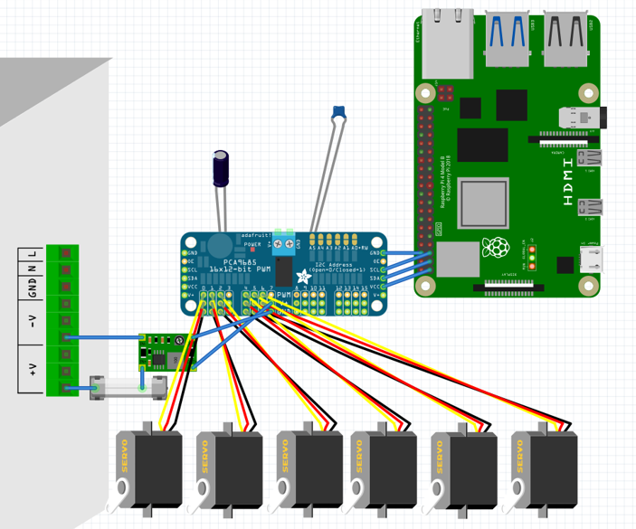

# Robotic Tic-Tac-Toe | Bachelor’s Thesis

**Integration, Control and Programming of a Multi-DOF Robotic Arm for a Physical Tic-Tac-Toe Game**  
Bachelor’s thesis · Robotics · Technical University of Cluj-Napoca · 2026  
**Author:** Mihai-Cezar Moldovan

## Overview

A semi-autonomous robotic Tic-Tac-Toe system that connects **software-based game decisions** with **physical pick-and-place manipulation**. A human plays **X** through a Python Tkinter interface; the robotic arm plays **O**, selects an available board position using a Minimax-based algorithm, and executes a calibrated motion sequence to place a physical piece.

The project integrates a purchased **6-DOF educational robotic arm kit**, servo actuation, a Raspberry Pi 4, a PCA9685 PWM driver, a gripper, and a custom game board with designed pieces and holders. My work focused on hardware/control integration, creating the game environment, developing the software, experimentally calibrating positions, and testing the integrated system—not designing the arm kit from scratch.

> **Demo:** A video of the working prototype will be added here.  
> **Project photos:** Photos of the assembled system will be added to [`images/`](images/).

## Key features

- **Human–robot interaction:** Interactive 3×3 Tkinter board, turn management, win/draw detection, restart control.
- **Decision-making:** Recursive Minimax-based move selection, with an optional probability of non-optimal moves to vary gameplay.
- **Physical execution:** Predefined, experimentally calibrated six-servo positions for piece pickup and all nine board cells.
- **Motion sequencing:** Approach → grip → lift → transfer → place → release → retreat/home, with interpolated servo moves.
- **Calibration tooling:** A position tester can execute complete sequences or individual poses for troubleshooting.
- **Testing mode:** The main program can print servo commands without actuating the robot.

## Hardware and software

| Area | Components / tools |
| --- | --- |
| Manipulator | Purchased 6-DOF robotic arm kit, servo-driven joints, gripper |
| Embedded controller | Raspberry Pi 4 |
| Servo control | PCA9685 16-channel PWM servo driver; `adafruit_servokit` Python library |
| Power | External supply and DC–DC buck converter |
| Programming | Python, Tkinter, threading, recursive Minimax |
| Mechanical environment | Custom CAD-designed board, X/O pieces and piece supports; 3D printing |
| Engineering documentation | CAD illustrations, electrical architecture and technical calculations |

## Hardware wiring and electronic architecture

The controller is a **Raspberry Pi 4**, which communicates with the **PCA9685 16-channel PWM servo driver** over **I²C**. The driver generates control signals for the robotic arm's servomotors. The diagram also illustrates the external servo power path and supporting components. Power distribution and common grounding must be checked against the actual assembled system before hardware operation.



- [View the Fritzing wiring diagram](images/fritzing-wiring-diagram.png)
- [Download the editable Fritzing project (.fz)](hardware/robotic-arm-wiring.fz)

The diagram documents the project's wiring design; it is **not** a substitute for checking component voltage/current ratings or validating the physical wiring.

## Operating sequence

```text
Human selects X in the GUI
         ↓
Update and validate game state
         ↓
Check win/draw; choose robot move (Minimax / optional random move)
         ↓
Map selected grid cell to calibrated board position
         ↓
Move arm to next O piece → close gripper → lift
         ↓
Move to board cell → open gripper → return home
         ↓
Enable next human turn
```

The board uses this physical numbering convention:

```text
7 | 8 | 9
--+---+--
4 | 5 | 6
--+---+--
1 | 2 | 3
```

## Repository structure

```text
robotic-arm-tic-tac-toe/
├── README.md
├── .gitignore
├── src/
│   ├── autonomous_tic_tac_toe_robot.py
│   ├── autonomous_tic_tac_toe_robot_v3_manual_settings.py
│   └── robot_position_tester.py
├── images/
│   └── fritzing-wiring-diagram.png
└── hardware/
    └── robotic-arm-wiring.fz
```

## How to run

**Desktop / simulated mode (no connected servos):**

1. Use a Python 3 installation with Tkinter support.
2. Confirm `USE_ROBOT = False` in `src/autonomous_tic_tac_toe_robot.py` (this is the current default).
3. Launch:

```bash
python src/autonomous_tic_tac_toe_robot.py
```

The game GUI opens, and servo commands are printed to the terminal instead of being sent to a real arm. Motion sequences still include programmed time delays.

**Physical robot:** Requires compatible wiring, Raspberry Pi hardware configuration, installed Adafruit ServoKit dependencies, power supply, and verification of **each servo's calibration, pulse widths, and mechanical travel limits**. The current primary file uses one global angle range of 0–270°, while the alternative and tester scripts apply more specific per-servo limits. These configurations are **not interchangeable without validation**. Only set `USE_ROBOT = True` after inspecting the entire motion path on your own hardware, with an accessible way to stop power. Do not run the position tester on connected hardware without checking the configured startup move.

## Development and calibration

The project uses **open-loop, pose-based control**, rather than automatic inverse kinematics or camera-based board recognition. Individual joint-angle sequences were calibrated experimentally for the fixed position of the board, the O-piece storage area, and the robotic base. [`robot_position_tester.py`](src/robot_position_tester.py) supports examining one step or running a complete pick/place sequence before integrating it into gameplay.

## Limitations and future improvements

- **No camera-based physical board recognition:** Human moves are registered in the GUI, and the real board must match that state.
- **Fixed workspace:** Moving the board, pieces, or robot base requires recalibration.
- **No gripper force or placement feedback:** The program cannot independently confirm a successful grasp or release.
- **Servo precision:** Mechanical backlash, power stability, and servo-angle limits affect repeatability.
- **Next steps:** Vision-based verification, sensor feedback, automatic calibration, and more advanced trajectory planning.

## Documentation

This README provides a public technical overview. The complete bachelor’s thesis and detailed project documentation are kept private.

## Academic context

Developed as a bachelor’s thesis in Robotics at the **Technical University of Cluj-Napoca**, Faculty of Industrial Engineering, Robotics and Management of Production, supervised by **Prof. Dr. Ing. Bogdan Mocan** (2026).
